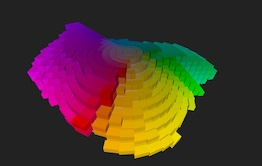

# Munsell-Color-Space-Viewer

<a href="https://sbecker11.github.io/munsell-color-space-viewer/" target="_blank" rel="noopener noreferrer"></a>


**RunMe:** [https://sbecker11.github.io/munsell-color-space-viewer/](https://sbecker11.github.io/munsell-color-space-viewer/)

## See my related project <a href="https://github.com/sbecker11/workspace-munsell" target="_blank">workspace-munsell</a>

##  Node setup (macos)  
install node using homebrew:  
```brew install node```  

or install node using curl: 
```/bin/bash -c "$(curl -fsSL https://raw.githubusercontent.com/Homebrew/install/HEAD/install.sh)"```  

verify node installation:  
```
node -v
npm -v
```

## Building and running the Node app locally
run thr following npm (node package manager) commands in your project's root directory.  
```
npm run clean
npm install
npm run build
npm run dev
```

